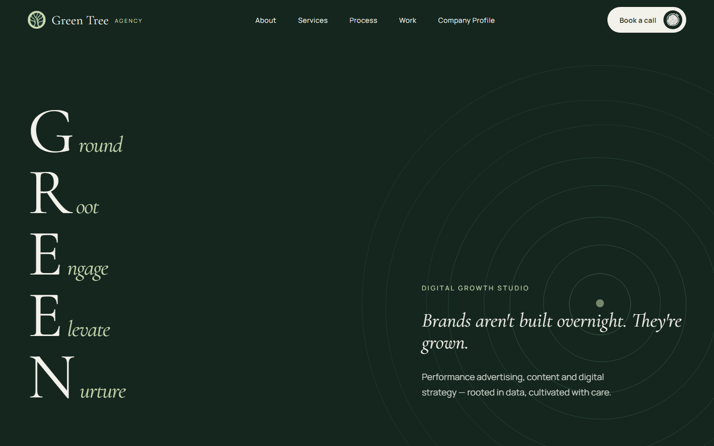

# Green Tree Agency — Landing Page

[](https://github.com/hoangthuan19071998/greentree-agency-landing/actions/workflows/ci.yml)

Marketing website for Green Tree Agency, a digital growth studio in Da Nang.

**Live:** https://greentree-agency.vercel.app



## Highlights

- **Pinned horizontal scroll journey** on large screens, built with plain React refs and scroll math (no animation library). It falls back to a normal vertical layout on tablets, short windows and when `prefers-reduced-motion` is on.
- **Custom cursor** rendered with `requestAnimationFrame`, enabled only on fine-pointer devices
- **Tap ripple** feedback on touch devices
- Scroll progress indicator and an animated tree-ring background (SVG)
- Contact modal with a service picker, and a downloadable company profile PDF
- Responsive from mobile to wide desktop

## Tech stack

React 19 · TypeScript · Vite · Tailwind CSS 4 · Lucide icons · Oxlint · Vercel

## Getting started

```bash
npm install
npm run dev      # start dev server
npm run build    # type-check and build
npm run lint     # oxlint
```

## Project structure

```
src/
├── App.tsx                    # layout, scroll progress, horizontal-journey switch
└── components/
    ├── HeroSection.tsx
    ├── HorizontalJourney.tsx  # pinned horizontal scroll section
    ├── ServicesSection.tsx
    ├── ProcessSection.tsx
    ├── SelectedWorkSection.tsx
    ├── ContactSection.tsx / ContactModal.tsx
    ├── CustomCursor.tsx / TapRipple.tsx
    └── TreeRingsBackground.tsx / TreeRingSymbol.tsx
```
